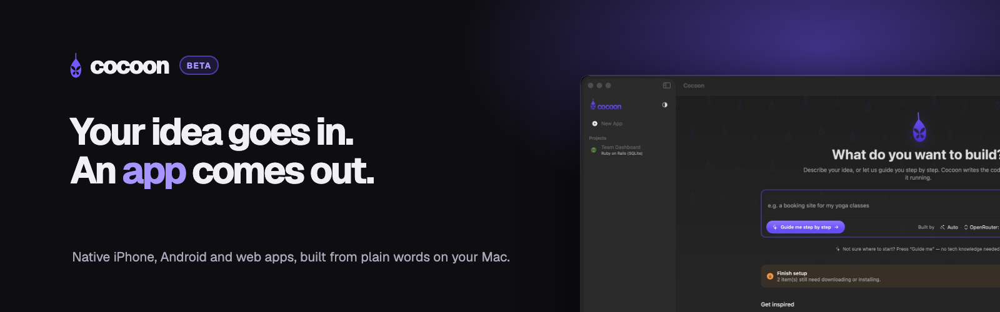
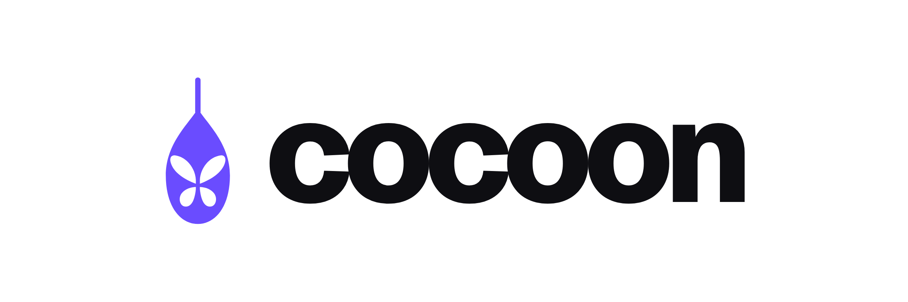

  

  <b>Cocoon is a Mac app for everyday people.</b> 
  Describe an app in plain words and Cocoon builds it: real websites and native iPhone and Android apps. 
  Watch it run on your Mac, change anything by asking, and ship it to the web, the App Store and Google Play.

  <a href="https://cocoon-app.github.io/download/Cocoon.dmg"><b>Download for Mac</b></a>
  &nbsp;·&nbsp;
  <a href="https://cocoon-app.github.io">Website</a>
  &nbsp;·&nbsp;
  <a href="https://github.com/cocoon-app/releases/issues/new/choose">Send feedback</a>

Beta · Macs with Apple silicon, macOS 26 or later · Signed and notarized by Apple

---

**What you can do with Cocoon**

- **Build without code.** A friendly guide asks a few questions, shows the plan, then builds.
- **Native apps.** iPhone apps in SwiftUI, Android apps in Kotlin, websites with real databases.
- **Your choice of AI.** Connect OpenRouter, Claude or OpenAI in one click.
- **Publish easily.** One click to the web (Vercel, Fly.io), and a guided checklist to the App Store and Google Play.
- **Always on GitHub.** Every app gets a private copy that syncs by itself, so a developer can take over anytime.

  <picture>
    <source media="(prefers-color-scheme: dark)" srcset="images/lockup-dark.png">
    
  </picture>

